<p align="center">
  <picture>
    <source media="(prefers-color-scheme: dark)" srcset="docs/media/hero-dark.webp">
    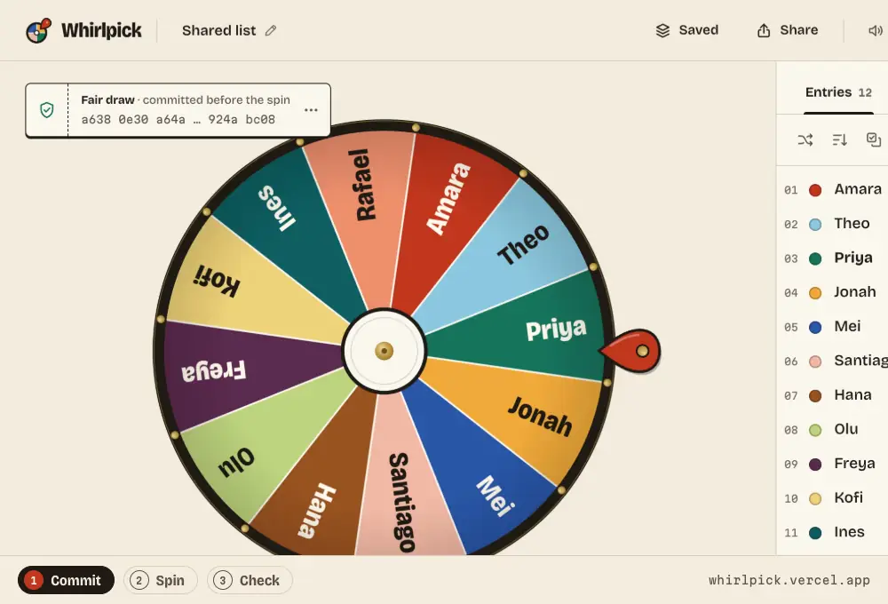
  </picture>
</p>

<p align="center">
  <a href="https://whirlpick.vercel.app">
    <picture>
      <source media="(prefers-color-scheme: dark)" srcset="apps/web/public/brand/wordmark-night.svg">
      
    </picture>
  </a>
</p>

<h3 align="center">Spin a wheel, then let anyone check the result.</h3>

<p align="center">
  Whirlpick is a spin wheel, name picker and team splitter. Every spin comes with a receipt that anyone can re-run.<br>
  It has no ads and no account, and your lists never leave your device.
</p>

<p align="center">
  <a href="https://whirlpick.vercel.app"></a>
</p>

<p align="center">
  <a href="LICENSE"></a>
  
  
  
  <a href="AGENTS.md"></a>
</p>

<p align="center">
  <a href="#a-fair-draw-start-to-finish">Demo</a> ·
  <a href="#features">Features</a> ·
  <a href="#privacy">Privacy</a> ·
  <a href="#how-a-fair-draw-works">How it works</a> ·
  <a href="#for-agents-cli-and-mcp">CLI and MCP</a> ·
  <a href="#run-it-locally">Run it</a>
</p>

---

## A fair draw, start to finish

Twelve names, one prize. Before the spin, Whirlpick shows a commitment: a hash of the secret seed that will decide the draw. You post it in the chat. After the spin it reveals the seed, and anyone can paste the receipt into the verify page and watch the same winner come out again.

<table>
  <tr>
    <td width="33%">
      <picture>
        <source media="(prefers-color-scheme: dark)" srcset="docs/screenshots/fair-desktop-dark.webp">
        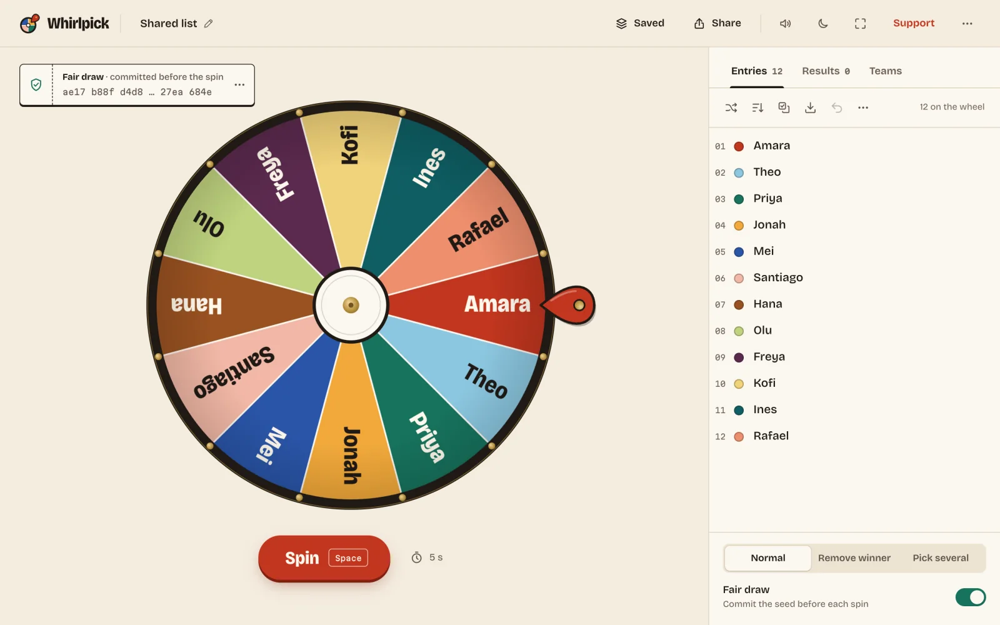
      </picture>
      <br><sub><b>1. Commit.</b> The ticket shows the hash before the wheel moves.</sub>
    </td>
    <td width="33%">
      <picture>
        <source media="(prefers-color-scheme: dark)" srcset="docs/screenshots/winner-desktop-dark.webp">
        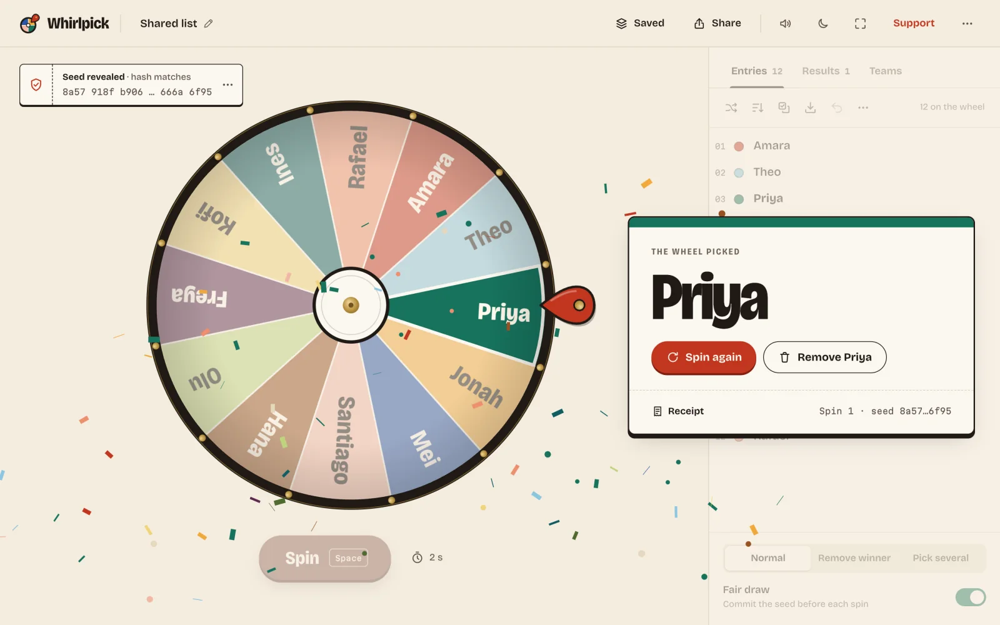
      </picture>
      <br><sub><b>2. Spin.</b> The winner was decided first; the wheel lands on it.</sub>
    </td>
    <td width="33%">
      <picture>
        <source media="(prefers-color-scheme: dark)" srcset="docs/screenshots/verifyok-desktop-dark.webp">
        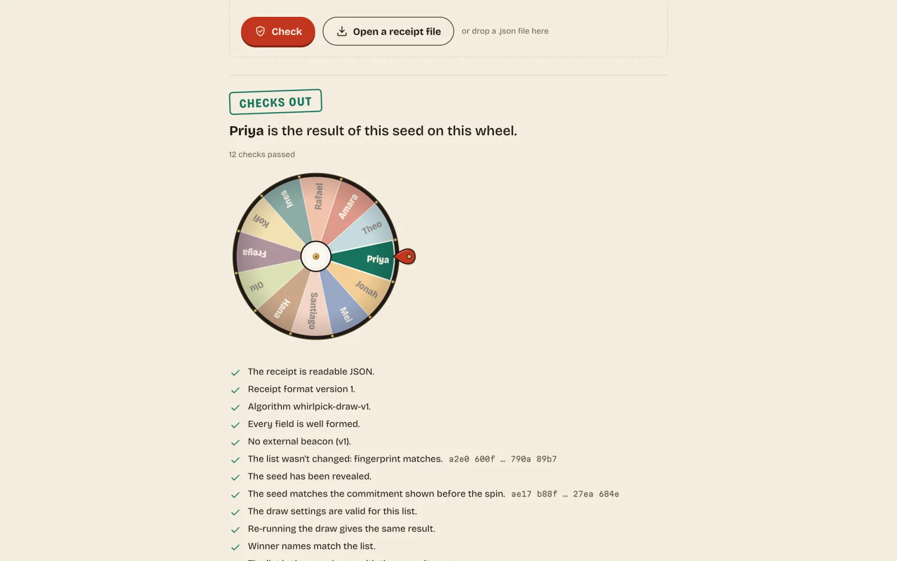
      </picture>
      <br><sub><b>3. Check.</b> Anyone re-runs the draw on /verify or with the CLI.</sub>
    </td>
  </tr>
</table>

## Why Whirlpick

- **Every spin can be checked.** Most wheels animate first and never show how they picked. Whirlpick picks from a documented algorithm, keeps a receipt and lets anyone re-run it. That settles "the wheel is rigged" for a raffle, a giveaway or who presents first.
- **No ads, no account, no upload.** It's a static site. Class lists and entrant names stay in your browser.
- **Teams, done properly.** Balanced skill levels, people kept apart or together, and new rounds that avoid repeat teammates.
- **Agents can run it too.** The same draw runs as a CLI with `--json` and as a local MCP server, with the same result byte for byte.
- **Free.** MIT licensed, with no locked features and no watermark.

## Features

### Spin

- Paste names one per line, or paste two columns from a spreadsheet to get names and weights. Import `.txt` or `.csv`.
- Shuffle, sort, remove duplicates, clear, undo. Give an entry a weight, a colour or an image, or switch it off without deleting it.
- Spin by clicking the wheel or the hub, with the Spin button, or with Space. Ctrl+Enter spins from anywhere. Press Space again to skip to the end.
- Spin length from 1 to 30 seconds. The pick clacks over brass pegs with sounds synthesised in the browser, and the reveal ends in paper confetti.
- Modes: normal, remove the winner after each spin, and pick several winners one by one or all at once.
- Preset wheels: yes/no, yes/no/maybe, coin flip, numbers 1–10, 1–100 or any range up to 1,000, letters A–Z, food, truth or dare, chores and all 195 countries.
- Mystery mode hides the labels until the result. From 2 to 1,000 entries; past about 100 the labels drop and the pick still names the winner.

### Fair draw

- Switch on **Fair draw** and the ticket shows the seed's commitment and the list fingerprint before the spin. The seed is revealed after it.
- Every spin, fair draw or not, gets a receipt: algorithm version, full list, fingerprint, seed, spin number and result.
- Copy the receipt, download it, or share a replay link that plays the exact same draw on another screen.
- The [verify page](https://whirlpick.vercel.app/verify/) checks a receipt in plain words: "The list wasn't changed", "The seed matches the commitment shown before the spin", "Re-running the draw gives the same result".
- An optional room word: after people see the commitment, ask them for a word and mix it in. See [what a receipt doesn't prove](#what-a-receipt-doesnt-prove).

### Teams

- Split into a number of teams, or teams of a set size.
- Tag people with a group or a skill level and keep tags balanced: each tag is spread evenly, within one per team.
- Keep two people apart, or keep a pair together. If the rules can't all be met, Whirlpick says so instead of quietly breaking one.
- **New round** makes a fresh split that avoids repeat teammates from earlier rounds.
- Copy teams as text or CSV, show them fullscreen, and get a receipt for the split.

### Save and share

- Keep a saved wheel per class, team or event. Open, rename, duplicate and delete them, with undo.
- Share a wheel as a link or a QR code. The list travels inside the link itself, in the part after `#`, which browsers never send to a server.
- Export and import `.whirl.json` project files with a published JSON Schema.
- A history of every spin with timestamps and receipts, exportable as CSV or JSON.

### Classroom and stream

- **Presenter mode** (press F) fills the screen with the wheel and shows the winner's name at 160 px, readable from the back of a classroom.
- Remove-the-winner mode with "Put everyone back" so every student gets a turn.
- **Stream mode** for OBS: `?stream=green`, `?stream=magenta` or a transparent background, with no chrome, just the wheel and the result caption.
- **Embed** the wheel in any page with an iframe, and drive it with a documented `postMessage` API: spin, set entries, read results.
- Mute with M. Everything works from the keyboard, and screen readers get the editor list as the model of the wheel plus a spoken winner.
- Light and dark themes, five wheel palettes including a chroma-safe Broadcast palette, and a label size setting.
- Installable, and fully offline after the first visit.

### For agents

- `whirlpick` CLI: `spin`, `teams`, `verify`, `commit`, `link`, `open`, `validate`, `presets`, `schema`. Every command takes `--json` and has stable exit codes.
- `whirlpick-mcp`, a local stdio MCP server with seven tools: `spin_wheel`, `split_teams`, `verify_receipt`, `create_commitment`, `make_share_link`, `validate_wheel`, `list_presets`.
- An agent can commit to a seed, post the commitment, spin, and hand people a replay link that plays the draw on a screen. The details are in [AGENTS.md](AGENTS.md).

## Privacy

Whirlpick is a set of static files with no server behind them. Once the page has loaded it makes no network requests: no analytics, no ads, no fonts from a font service and no third-party scripts. Saved wheels live in your browser's IndexedDB, on your device only. Share links carry the wheel in the URL fragment, which browsers don't send when they load a page, and images you add to slices are left out of links altogether. Deleting a wheel removes it for good, because no other copy exists.

The CLI and MCP server run on your machine and make no network calls either. There are no API keys and no accounts anywhere.

## How a fair draw works

Whirlpick decides the winner first and animates second.

1. **Seed.** Each draw starts from a 256-bit random seed from `crypto.getRandomValues`.
2. **Commitment.** In fair-draw mode the app shows the SHA-256 hash of the seed and a fingerprint of the list before the spin. Anyone can screenshot both.
3. **Draw.** The algorithm, `whirlpick-draw-v1`, feeds the seed, the list fingerprint and the spin number through SHA-256 and reads the winner out of the result. It uses rejection sampling, so weights are exact and there's no modulo bias. The wheel then lands on the winner's slice, never on a line between two slices.
4. **Reveal.** After the spin the seed is shown. Hashing it must give the commitment people saw, and re-running the draw with it must give the same winner.
5. **Check.** Paste the receipt into [/verify/](https://whirlpick.vercel.app/verify/), run `whirlpick verify receipt.json`, or write your own checker from the [spec](https://whirlpick.vercel.app/about/#algorithm). The repo includes a Python checker that uses only the standard library.

The same seed and list give the same result in the browser, the CLI and the MCP server.

### What a receipt doesn't prove

A commitment shows the seed wasn't changed after it was published. It can't stop a host from generating many seeds *before* committing and keeping one they like. The room word covers that case: it's given after the commitment is public, so the host can't know it in advance. No third party audits or signs off on a draw. The claim is narrower and checkable: the result follows from the published algorithm, the seed and the list in the receipt.

## For agents: CLI and MCP

The CLI isn't on npm yet, so run it from a clone. You need Node 24 or newer and pnpm 11.

```bash
pnpm i && pnpm build:packages
pnpm whirlpick spin --entries "Ada,Grace,Linus"
```

A public draw an audience can check:

```bash
printf 'Amara\nTheo\nPriya\nJonah\nMei\nSantiago\n' > names.txt
pnpm whirlpick commit --out seed.json          # prints the commitment; post it before the draw
pnpm whirlpick spin names.txt --seed-file seed.json --count 2 --public-input "blue sky" \
  --receipt-out receipt.json --link            # winners, a receipt file and a replay link
pnpm whirlpick verify receipt.json --commitment <the hash you posted>
```

```text
Valid: the draw checks out.
  ok   The list wasn't changed: fingerprint matches.
  ok   The seed matches the commitment shown before the spin.
  ok   The commitment matches the one you saw.
  ok   Re-running the draw gives the same result.
  ...
```

Balanced teams with a rule:

```bash
pnpm whirlpick teams --entries "Ada,Grace,Linus,Margaret,Priya,Tomas" --teams 2 --apart "Ada,Grace"
```

Exit code `0` is success, `4` means a receipt failed verification and `6` means the draw can't be done, for example three winners from two names. Add `--json` to any command for one JSON document on stdout.

To use the MCP server, point your client at it:

```json
{
  "mcpServers": {
    "whirlpick": {
      "command": "node",
      "args": ["/abs/path/whirlpick/packages/cli/bin/whirlpick-mcp.js", "--root", "/abs/path/to/your/files"]
    }
  }
}
```

File access stays inside `--root`. The full reference, with every flag, tool schema, the receipt format and worked examples, is in [AGENTS.md](AGENTS.md).

## Run it locally

You need Node 24 or newer and pnpm 11.

```bash
pnpm i && pnpm dev
```

Then open http://127.0.0.1:4323.

## Self-host

Whirlpick builds to plain static files. There are no environment variables, API routes or databases, so any static host works.

```bash
pnpm i && pnpm build    # writes apps/web/dist/
pnpm serve              # optional: preview it at http://127.0.0.1:4324
```

Upload `apps/web/dist/` as is. It includes the offline service worker, the sitemap, `llms.txt` and the JSON Schemas under `/schema/`.

## Tested

- 347 unit and golden tests across the core, the CLI and MCP over stdio, and the web app: `pnpm test`.
- Fairness: chi-square over 100,000 seeded spins for uniform and weighted wheels, 2 to 100 entries. Every fixture passes at p > 0.001.
- Geometry: 100,000 generated wheels, and the landing point is always inside the winner's slice, clear of its edges.
- An independent Python reference reproduces the draw from the written spec: `pnpm test:ref`.
- Playwright end-to-end tests in Chrome with axe accessibility checks, including a check that the browser and the CLI pick the same winners from the same seed and list.

## Screenshots

<table>
  <tr>
    <td width="50%"></td>
    <td width="50%">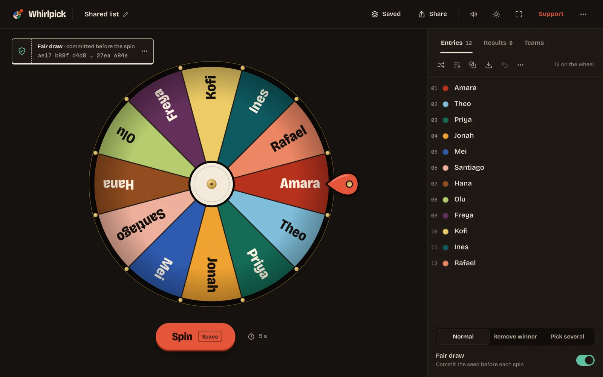</td>
  </tr>
  <tr>
    <td width="50%">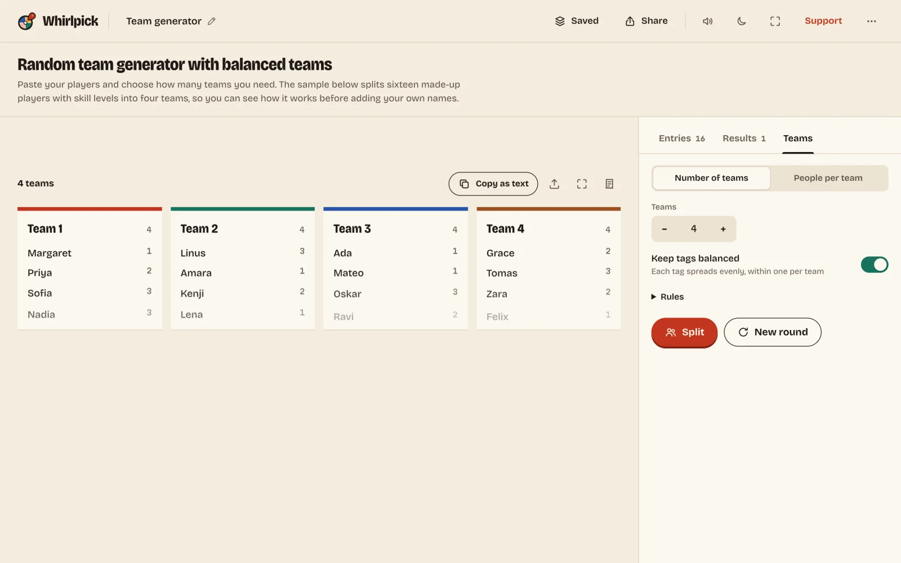</td>
    <td width="50%">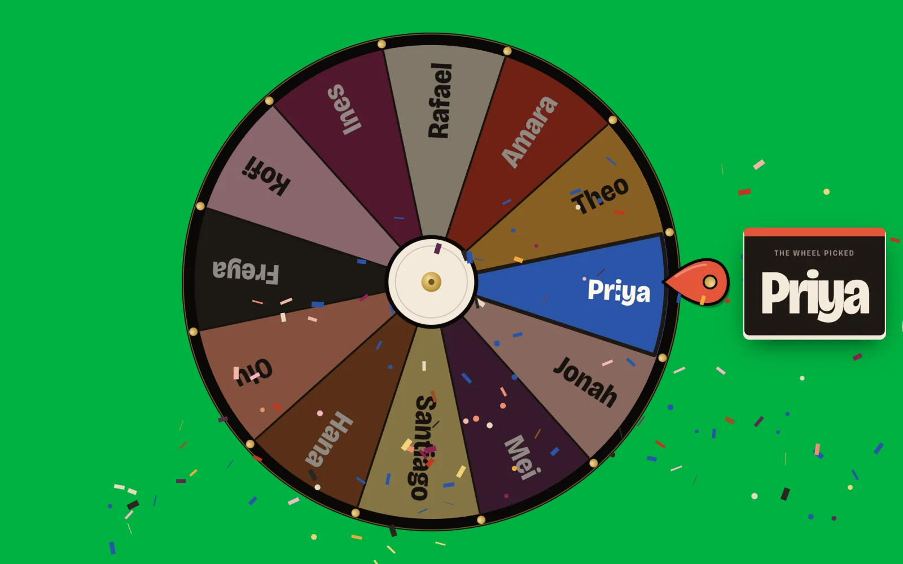</td>
  </tr>
</table>

<table>
  <tr>
    <td>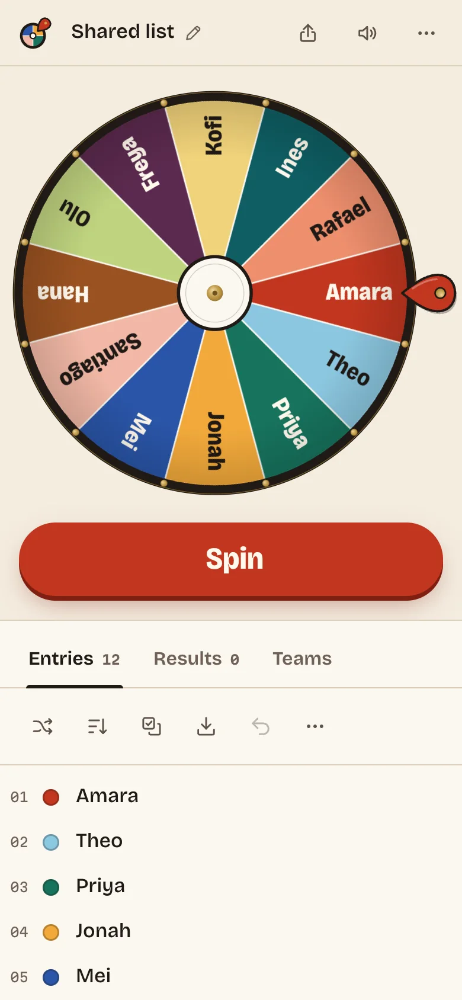</td>
    <td>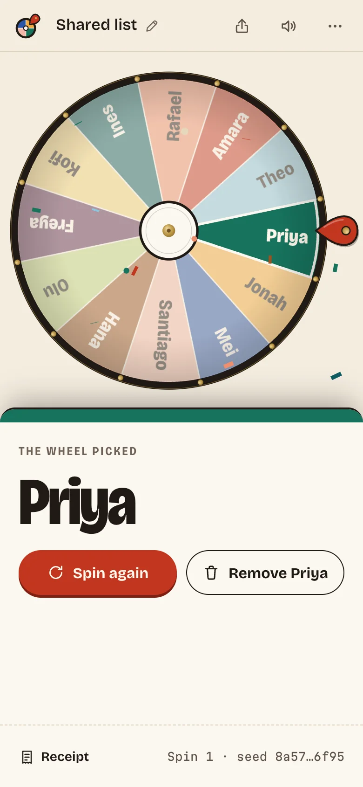</td>
    <td>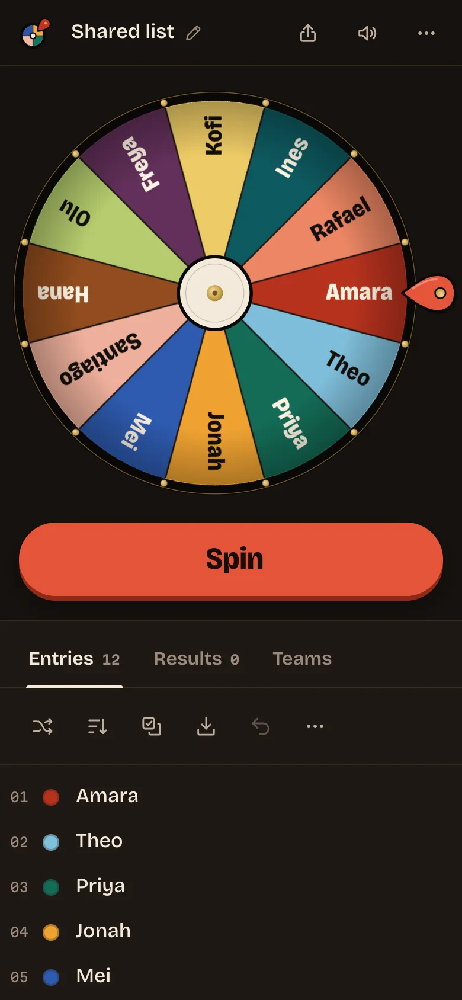</td>
    <td>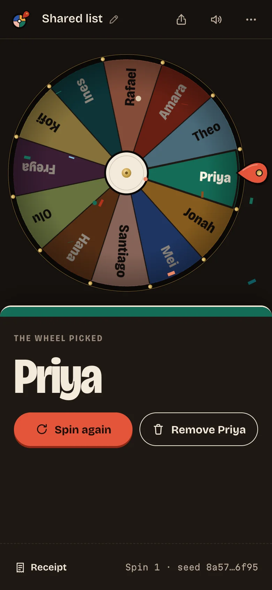</td>
  </tr>
</table>

## Project layout

| Path | What it is |
| --- | --- |
| [`packages/core`](packages/core) | The draw algorithm, receipts and verifier, teams, spin geometry, project schema and share links. Pure TypeScript with no DOM or Node APIs. |
| [`packages/cli`](packages/cli) | `whirlpick` and `whirlpick-mcp`. |
| [`apps/web`](apps/web) | The static site: Canvas wheel, WebAudio sounds, offline service worker and keyword pages. |
| [`scripts/ref`](scripts/ref) | The Python reference checker. |

## Credits

Whirlpick uses [@noble/hashes](https://github.com/paulmillr/noble-hashes) for SHA-256, [React](https://react.dev), [qr](https://github.com/paulmillr/qr), [Zod](https://zod.dev), the [MCP TypeScript SDK](https://github.com/modelcontextprotocol/typescript-sdk) and [Vite](https://vite.dev). Type is set in [Bricolage Grotesque](https://github.com/ateliertriay/bricolage) and [Martian Mono](https://github.com/evilmartians/mono), both under the SIL Open Font License 1.1. The wheel renderer, the sounds, the confetti, the logo and the icons were made for Whirlpick and are MIT licensed. Every name in the presets and screenshots is made up. Full notices are in [CREDITS.md](CREDITS.md).

## License

[MIT](LICENSE) © 2026 Bilal Tahir

## Support

Whirlpick is free and ad-free. If it settled an argument about who won, you can [support the project](https://whirlpick.vercel.app/support/) with a one-off tip or a small monthly contribution.
